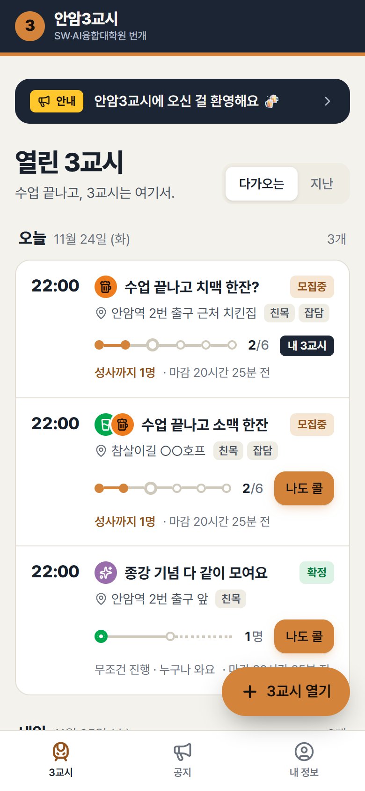
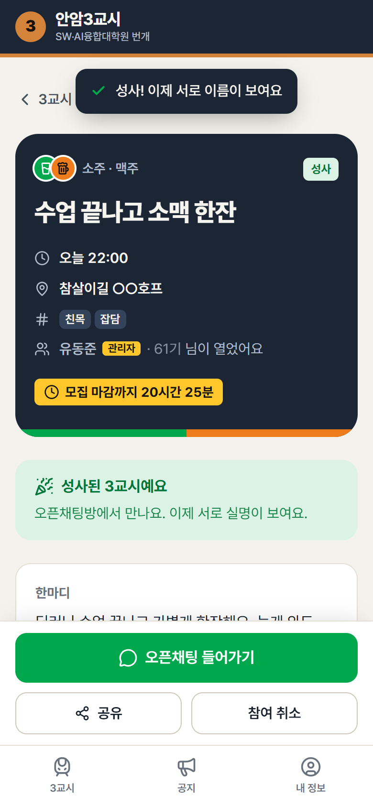

# 안암3교시 🍻

> 수업 끝나고, 3교시는 여기서.

고려대학교 SW·AI융합대학원 동기·선후배가 수업 끝나고 함께할 번개 모임을 부담 없이 열고 참여하는 웹 서비스예요.
이 서비스에서는 그 번개를 **3교시**라고 불러요.

| 모바일 — 열린 3교시 | 모바일 — 성사! | 데스크톱 — 3교시 상세 |
| :---: | :---: | :---: |
|  |  |  |

## 어떻게 동작하나요

1. 누군가 3교시를 열어요. 마실 것, 시간, 장소, 인원(최소·최대 또는 제한 없음)을 정해요.
2. 다른 사람들이 **나도 콜**로 참여해요. 성사 전까지 이름은 `김*수 · 61기 · 인융`처럼 가려져요.
3. 최소 인원이 모이면 **성사**! 참여자끼리만 실명과 카카오톡 오픈채팅 링크가 공개돼요.
4. 마감까지 인원이 안 모이면 목록에서 조용히 사라져요.

이름 가리기는 화면이 아니라 서버에서 처리해요 ([`MeetupMapper.java`](backend/src/main/java/com/anam3/meetup/MeetupMapper.java)).

## 주요 기능

- 3교시 열기 · 참여 · 단톡방 공유, 다가오는/지난 3교시
- 공지 게시판 (누구나 작성)
- 입장 코드로만 가입, 기수·학과 표시
- 관리자 페이지 (회원 관리, 입장 코드)
- 모바일·데스크톱 반응형, 다크 모드

## 기술 스택

- **백엔드**: Java 25, Spring Boot 4, Spring Security (JWT), Spring Data JPA, Flyway
- **프론트엔드**: React 19, TypeScript, Vite, Tailwind CSS v4, TanStack Query
- **DB**: PostgreSQL (로컬 개발은 설치 없이 H2 인메모리)
- **배포**: 화면과 API를 Docker 이미지 하나로 빌드해요. `main`에 합쳐지면 자동으로 배포돼요.

## 로컬에서 실행하기

필요한 것: Java 25, Node.js 22 이상. DB는 설치하지 않아도 되고, 샘플 데이터가 자동으로 들어가요.

```bash
# 백엔드 (http://localhost:8080)
cd backend
./mvnw spring-boot:run        # Windows: mvnw.cmd spring-boot:run

# 프론트엔드 (http://localhost:5173) — 새 터미널에서
cd frontend
npm install
npm run dev
```

http://localhost:5173 에서 샘플 계정 `minsu` / `password1234` 로 로그인하면 돼요 (로컬 전용 계정).

테스트:

```bash
cd backend && ./mvnw test
cd frontend && npm run lint && npm test
```

## 함께 만들기

기능 제안, 버그 제보, 코드 기여 모두 환영해요. → [CONTRIBUTING.md](CONTRIBUTING.md)

학생들이 만든 비공식 프로젝트로, 고려대학교의 공식 서비스가 아니에요. · [MIT License](LICENSE)
