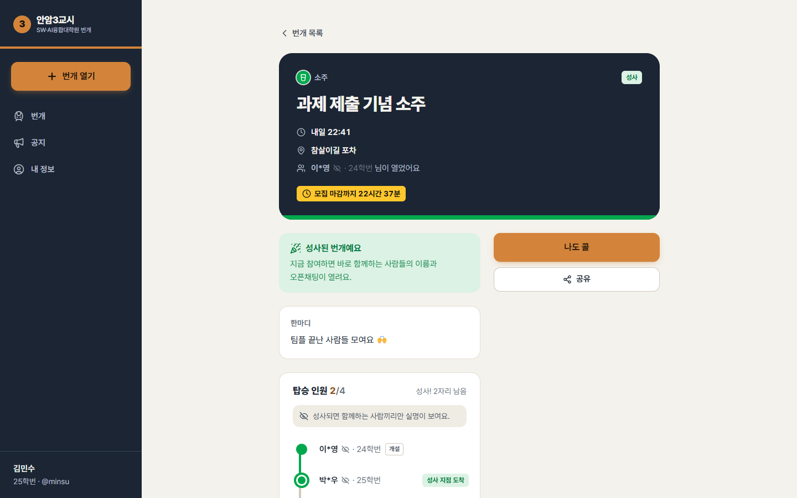

# 안암3교시 🍻

> 수업 끝나고, 3교시는 여기서.

IT연합회(고려대·연세대·성균관대·서강대·한양대) 대학원 원우가 수업 끝나고 함께할 번개 모임을 부담 없이 열고 참여하는 웹 서비스예요.
이 서비스에서는 그 번개를 **3교시**라고 불러요.

| 모바일 — 열린 3교시 | 모바일 — 성사! | 데스크톱 — 3교시 상세 |
| :---: | :---: | :---: |
|  |  |  |

## 어떻게 동작하나요

1. 누군가 3교시를 열어요. 마실 것, 시간, 장소, 인원(최소·최대 또는 제한 없음)을 정해요.
2. 다른 사람들이 **나도 콜**로 참여해요. 성사 전까지 이름은 `김*대 · 61기 · 인융`처럼 가려져요.
3. 최소 인원이 모이면 **성사**! 참여자끼리만 실명과 카카오톡 오픈채팅 링크가 공개돼요.
4. 마감까지 인원이 안 모이면 목록에서 조용히 사라져요.

이름 가리기는 화면이 아니라 서버에서 처리해요 ([`MeetupMapper.java`](backend/src/main/java/com/anam3/meetup/MeetupMapper.java)).

## 주요 기능

- 3교시 열기 · 참여 · 단톡방 공유, 다가오는/지난 3교시
- **톡방**: 3교시마다 함께하는 원우끼리 실시간으로 글·사진을 주고받아요 (사진은 30일 보관). 연합 3교시는 이름 옆에 학교가 보여요
- **추억**: 모였던 3교시에 인생네컷·단체 사진과 한 줄을 남겨요 (함께한 원우만 / 모두에게 공개)
- **우리 학교** 게시판과 **연합** 게시판(다섯 학교 누구나). 3교시를 열 때 우리 학교 · 우리 기수만 · 연합 중에서 골라요
- **학교 색 테마** — 로그인하면 화면이 우리 학교 상징색으로 바뀌어요 (기본 색·밝게·어둡게로 바꿀 수 있어요)
- **학교별 화면 이름** — 공식 이름은 안암3교시, 로그인하면 우리 학교 동네로 보여요: 안암3교시 · 신촌3교시 · 서강3교시 · 혜화3교시 · 왕십리3교시
- 이름 옆 **학교 배지** `✓ 고려대` — 학교 이메일로 인증했다는 표시
- 공지 게시판 (우리 학교 공지 + 대학원장의 연합 공지)
- **카카오 로그인** + 가입할 때 한 번 **학교 이메일 인증** — IT연합회 원우만 들어와요
- 학과·기수는 **내 정보**에서 직접 고쳐요 (원우는 30일에 한 번). 이름은 학교 이메일로 인증해서 고정 — 바꿀 땐 교수·대학원장에게 요청. 학과·최신 기수는 학교마다 달라요
- **빈자리 대기**: 정원이 차면 "자리 나면 알림". 연 사람은 대기 인원만 보고 정원을 늘려요 (거절 없음)
- **랭킹**: 방장왕 · 출석왕 · 성사율 · 연합왕, 학교 대항 참여율 (이번 달 · 전체). 이름은 가려서. 대학원장은 학교별로 골라 봐요
- **정산**: 계산한 원우가 총액을 넣으면 1인 금액(100원 올림)과 토스·카카오페이 송금 버튼, 누가 보냈는지까지. 돈은 서비스가 받지 않아요
- 새 3교시 알림(우리 학교 · 연합), 새 톡·새 추억 알림, 장소 자동완성, 지도 바로가기, 캘린더에 추가, 모임 1시간 전 알림, 밤에는 조용히, 지난 3교시 다시 열기
- 신고 · 차단 · 앱 안에서 탈퇴 · 약관 동의 · 심한 욕설 거르기
- 직책: **대학원장**(최고 관리자 1명, 모든 학교) · **교수**(대학원장이 임명, 자기 학교만) · **원우**
- 관리 화면: 원우 그리드(검색·거르기·정렬, 줄을 누르면 편집)와 학교별·기수별·학과별 통계, 신고 처리, 전체 3교시, 학교·도메인·학과·최신 기수 관리
- 모바일·데스크톱 반응형, 다크 모드

기획을 어떻게, 왜 그렇게 정했는지는 [docs/planning](docs/planning/README.md)에 남겨요.

## 기술 스택

- **백엔드**: Java 25, Spring Boot 4, Spring Security (JWT), Spring Data JPA, Flyway
- **프론트엔드**: React 19, TypeScript, Vite, Tailwind CSS v4, TanStack Query
- **DB**: PostgreSQL (로컬 개발은 설치 없이 H2 인메모리)
- **배포**: 화면과 API를 Docker 이미지 하나로 빌드해요. `main`에 합쳐지면 자동으로 배포돼요.

## 로컬에서 실행하기

필요한 것: Java 25, Node.js 22 이상. DB·카카오 키·메일 설정 없이 바로 실행되고, 샘플 데이터가 자동으로 들어가요.

```bash
# 백엔드 (http://localhost:8080)
cd backend
./mvnw spring-boot:run        # Windows: mvnw.cmd spring-boot:run

# 프론트엔드 (http://localhost:5173) — 새 터미널에서
cd frontend
npm install
npm run dev
```

http://localhost:5173 로그인 화면 아래 **개발용 로그인**에서 샘플 계정(대학원장·교수·원우, 다섯 학교)을 골라 들어가면 돼요.
개발용 로그인은 로컬 서버에서만 보이고, 운영에는 없어요.

- 카카오 로그인까지 시험하려면 `KAKAO_REST_API_KEY`, `KAKAO_CLIENT_SECRET` 환경변수를 넣고 백엔드를 실행하세요.
  (카카오 디벨로퍼스 Redirect URI에 `http://localhost:5173/auth/kakao/callback` 이 등록돼 있어야 해요)
- 학교 이메일 인증코드는 SMTP 설정이 없으면 메일 대신 **백엔드 로그**에 찍혀요.
- 사진은 R2 설정이 없으면 내 PC 임시 폴더(`PHOTO_DIR`로 바꿀 수 있어요)에 저장돼요.
- 예전(아이디·비밀번호 시절) 회원은 카카오 로그인 → 학교 이메일 인증 뒤 **예전 계정 잇기**에 예전 아이디·비밀번호를 넣으면 예전 기록이 그대로 이어져요. 로컬 샘플: `chamsari` / `anam1234`

테스트:

```bash
cd backend && ./mvnw test
cd frontend && npm run lint && npm test
```

## 배포 (Render)

[`render.yaml`](render.yaml) 로 만들어지고, `main`에 합쳐지면 자동으로 배포돼요. 넣어야 하는 환경변수:

| 이름 | 내용 |
|---|---|
| `DATABASE_URL` | Neon PostgreSQL 연결 문자열 (`postgresql://…`) |
| `JWT_SECRET` | 로그인 토큰 서명 키 (Render가 자동 생성) |
| `OWNER_EMAIL` | 대학원장(최고 관리자)의 학교 이메일. 이 이메일로 인증한 계정이 대학원장이 돼요 |
| `KAKAO_REST_API_KEY` / `KAKAO_CLIENT_SECRET` | 카카오 디벨로퍼스 > 앱 > 플랫폼 키 > REST API 키 |
| `SPRING_MAIL_HOST` / `SPRING_MAIL_PORT` / `SPRING_MAIL_USERNAME` / `SPRING_MAIL_PASSWORD` | 인증 메일 SMTP (예: Gmail `smtp.gmail.com` · `587` · 보내는 주소 · 앱 비밀번호) |
| `MAIL_FROM` | (선택) 보내는 사람 주소. 비우면 `SPRING_MAIL_USERNAME` |
| `SUPPORT_EMAIL` | (선택) 약관·내 정보 화면의 문의 이메일. 비우면 "교수·대학원장에게 문의"로 안내 |
| `KAKAO_APP_ID` | (앱) 카카오 앱 ID(숫자). 안드로이드 앱의 카카오톡 로그인에 필요 |
| `FIREBASE_SERVICE_ACCOUNT` | (앱) Firebase 서비스 계정 키 JSON. 없으면 앱 푸시를 보내지 않고 로그만 남겨요 |
| `REVIEW_EMAIL` / `REVIEW_PASSWORD` | (앱) 스토어 심사용 계정. 둘 다 넣으면 서버가 시작할 때 만들어요 |
| `R2_ACCOUNT_ID` / `R2_ACCESS_KEY_ID` / `R2_SECRET_ACCESS_KEY` / `R2_BUCKET` | 톡방·추억 사진 저장소 (Cloudflare R2). 넷 다 넣어야 써요. 버킷은 비공개, CORS에 사이트 주소의 PUT·GET 허용, 수명 규칙으로 `chat/` 아래를 30일 뒤 삭제 |
| `SCHOOL_TEST_PASSWORD` | (선택) 8자 이상이면 학교마다 시험 계정(`ku@test.anam3` 등)을 만들어요. 이메일 로그인으로 들어가요 |
| `ANDROID_CERT_SHA256` | (앱) 앱 서명 인증서 SHA-256 (쉼표로 여러 개). 공유 링크를 앱으로 열 때 필요 |

Render 무료 플랜은 SMTP 포트(25·465·587)를 막아서, 메일을 보내려면 유료 인스턴스(Starter)가 필요해요.

## 안드로이드 앱

`frontend/android` (Capacitor). 앱은 서버 화면을 그대로 열어서, 웹을 배포하면 앱에도 바로 반영돼요.
키 준비·빌드·Play Console 순서는 [docs/android-release.md](docs/android-release.md).

## 함께 만들기

기능 제안, 버그 제보, 코드 기여 모두 환영해요. → [CONTRIBUTING.md](CONTRIBUTING.md)

학생들이 만든 비공식 프로젝트로, 어느 학교의 공식 서비스도 아니에요. · [MIT License](LICENSE)
